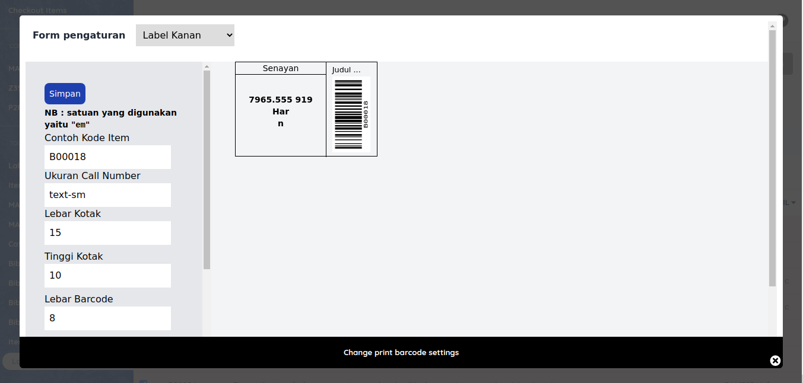
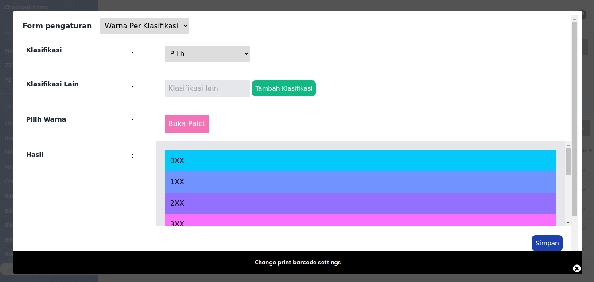

# Label Mixcode Color

Plugin cetak label dan barcode warna untuk Senayan Library Management System (SLiMS).  
Fork ini memuat pembaruan kompatibilitas untuk **SLiMS 9.8 ("Bulian D Ace")** dan **PHP 8.1+**.

### Fitur
* Kustomisasi warna label berdasarkan klasifikasi nomor panggil DDC (000–900).
* Menyediakan 3 posisi barcode:
  * **Right** (Barcode di kanan, 1 barcode)
  * **Left** (Barcode di kiri, 1 barcode)
  * **Both** (Barcode di kanan & kiri, 2 barcode)
* Desain dimensi kotak, ukuran barcode, dan margin cetak fleksibel.

### Pembaruan Kompatibilitas (Fork)
* Mendukung penuh **SLiMS 9.8** dan **PHP 8.1+** (mengatasi error handler HTTP 500).
* Penanganan nomor panggil tunggal tanpa spasi (`FIC`, `REF`) dan prefix multi-kata (`REF R ...`).
* Perbaikan form pencarian bibliografi (parameter `mod` & `id` tidak hilang saat submit).
* Penyelarasan orientasi rotasi barcode (rotasi 90° sisi kiri) agar simetris dengan preview antarmuka.
* Perbaikan validasi template pengaturan cetak.

### Kebutuhan Sistem
* SLiMS 9.3.x s.d. 9.8.x
* PHP 7.4 s.d. 8.1+
* Ekstensi PHP: `gd`, `mysqli`, `pdo_mysql`

### Lisensi & Kredit
* Dikembangkan pertama kali oleh [Drajat Hasan](https://github.com/drajathasan/label_mixcode_color_slims).
* Dilisensikan di bawah lisensi GPL-3.0.
